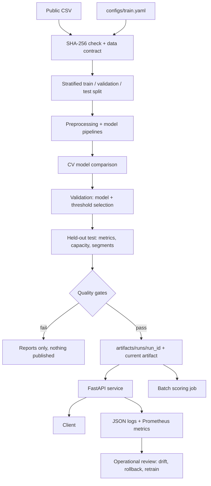

# Architecture and design decisions

- Keep preprocessing in the fitted model pipeline to reduce training-serving skew.
- Remove customer identifiers to reduce memorization risk.
- Pin the dataset version by checksum; fail loudly if it changes.
- Choose models using cross-validation on training data only.
- Select the threshold on validation data; use the test set only for final evaluation.
- Gate publishing on test metrics; keep every published version immutable for rollback.
- Evaluate by segment, not just overall: aggregate metrics can hide groups the model fails.
- Training settings come from YAML; serving settings from `CHURN_*` environment variables.
- Batch and online scoring share one service, so they cannot drift apart.
- Treat threshold costs as assumptions until validated with business stakeholders.
- Load `joblib` artifacts only from trusted sources.
